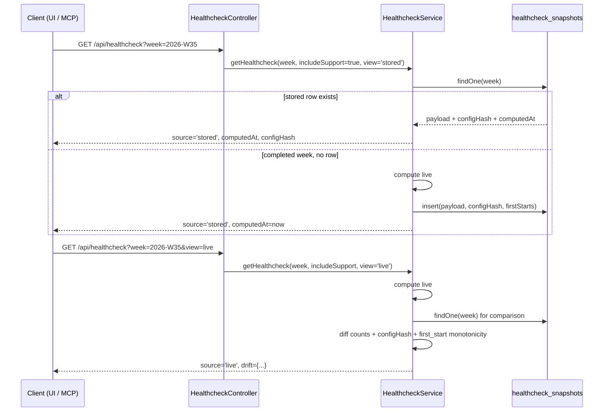

# 0086 — Healthcheck reproducibility: stored weeks, config hash, explicit live view

**Date:** 2026-09-14
**Status:** Accepted
**Author:** Architect Agent
**Related ADRs:** builds on 0070 (Healthcheck single-denominator model), 0074 (org-wide pooling),
0091 (`includeSupport` toggle); proposes 0092
**Investigation:** 2026-W35 stability denominator instability (26.67% vs 30.43%)

## Problem Statement

`GET /api/healthcheck` is computed live from the Postgres Jira mirror on every call and persists
nothing (ADR 0070). Two consequences surfaced while investigating a report that the same closed
week — `2026-W35` — returned 26.67% on 7–8 Sep and 30.43% on 14 Sep, both with the default
`includeSupport=true`.

1. **A closed week's figure is not reproducible and drift is silent.** There is no `computedAt`,
   no stored numerator/denominator/ticket list, and no record of the predicate configuration the
   figure was derived under. When two runs disagree there is nothing to diff, so the question
   "did the data change, the config change, or the code change?" is unanswerable after the fact.
   It took a full independent reconstruction from the Jira API to establish even that the 14 Sep
   figure was the correct one.

2. **A ticket with no stored status history leaves the denominator silently.** For a scrum board
   `firstStartDate` returns `null` when no transition into an in-progress status is found, and the
   ticket is then simply absent — no error, no warning, no "excluded for missing data" count. An
   incomplete mirror is therefore indistinguishable from work that genuinely never started.

### What the investigation established

An independent reconstruction (full changelogs pulled from the Jira API for all 362 candidate
issues on the five scrum boards, `first_start` recomputed from scratch) puts the true W35
denominator at exactly **23**, matching the 14 Sep figure of 7/23 = 30.43% and reproducing the
whole 38-row ticket array (23 scrum + 15 PLAT under the kanban board-entry signal). Ruled out:

- **Jira-side changelog truncation** — 0 of 362 issues had a short fetch; the API returns
  oldest-first, so a truncated read drops the newest entries and cannot move a minimum later.
- **Board membership / the `sprint is not EMPTY` sync predicate** — all 23 tickets had a non-empty
  sprint field on 7 Sep (verified by replaying their Sprint changelog to that date).
- **`inProgressStatusNames` drift** — the W35 denominator is 23 under every config from the schema
  default `['In Progress']` up to the full 23-entry list.
- **Any additive leak** — the Epic/Sub-task filter being bypassed gives 28; PLAT mis-typed as
  scrum gives 35–36; both together 41; the all-boards kanban-entry set is 38. None of these
  display as 26.7%.
- **A whole board dropping out** — the per-board contributions are ACC 6, BPT 5, DATA 5, OCS 1,
  SPS 6; no subset sums to the 8 that would need to be lost.

26.67% requires a denominator of 15, 30, 45, 60 or 75. Nothing additive reaches 30+, and no
board-level loss reaches 15, so the 7–8 Sep run was short by **8 tickets spread across boards** —
a per-ticket loss. The only mechanism that produces that is an incomplete stored changelog.

3. **`syncIssueChangelog` replaced the stored changelog destructively and non-atomically**, which
   is exactly that mechanism:

   ```ts
   const entries = this.mapChangelogEntries(issueKey, response.values);
   if (entries.length > 0) {
     if (startAt === 0) await this.changelogRepo.delete({ issueKey });  // destructive
     await this.changelogRepo.save(entries);
   }
   startAt += response.maxResults;
   ```

   - Between the `delete` and the `save` the issue has **zero** changelog rows. The daily full
     sync performs this for every issue on every board, so any concurrent read can observe an
     issue that appears never to have started.
   - If a later page throws (Jira 429 past the retry budget, a network blip), the exception
     propagates to `syncBoard`'s catch and the issue is left **permanently** truncated or empty
     until some later sync happens to touch it again. `syncChangelogsBulk` runs `Promise.all` over
     batches of 5, so an aborting run can leave several issues mid-replace.
   - `startAt += response.maxResults` never advances if `maxResults` is 0 — an infinite loop.

   A handful of issues left with no history, spread across the boards that were being synced when
   a run aborted, then self-healing on the next successful run, matches the observation. **This is
   not proven:** confirming it needs `sync_logs` and `jira_changelogs` from the production
   database, which is a private RDS instance (correctly) unreachable from a developer machine. A
   diagnostic query is provided at `backend/src/scripts/check-changelog-completeness.ts`.

### Secondary findings

4. **`first_start` was not computed as a minimum.** `firstStartDate` used `logs.find()`, which
   depended on the caller supplying the changelog in ascending `changedAt` order via an `ORDER BY`
   in `healthcheck.service.ts`. The definition is a minimum over an append-only history; computing
   it as one removes a latent class of "closed week moved" bug. *Fixed directly —
   behaviour-preserving under the current caller. Not the cause of this incident.*

5. **`inProgressStatusNames` is unversioned and silently re-seeded.** It is a mutable
   `board_configs` column with no `updatedAt` and no audit trail, editable via
   `PUT /api/boards/:boardId/config`, and `YamlConfigService.onApplicationBootstrap` re-applies
   `config/boards.yaml` — baked into the container image at build time — on **every** application
   boot. Any ECS task restart can revert a UI edit and any deploy can change the predicate, with
   no trace. Not the cause here (the denominator is config-invariant for this week), but it is why
   eliminating the possibility required a full external reconstruction. *Made observable via the
   config hash below; not otherwise fixed.*

## Proposed Solution

### 1. Persist the canonical week on first read (`healthcheck_snapshots`)

One row per ISO week, holding the **canonical** view (`includeSupport=true`):

```
week          varchar   PK        e.g. "2026-W35"
weekStart     timestamptz
weekEnd       timestamptz
payload       jsonb               the full HealthcheckResponse (canonical view)
configHash    varchar             see below
firstStarts   jsonb               { [issueKey]: ISO8601 } — derived first_start per ticket
computedAt    timestamptz
```

Write-through on read: a request for a **completed** week with no stored row computes, stores, and
returns the stored figure. The current (in-flight) week is never stored — it is legitimately
still moving. No new cron job and no change to the sync path; the existing snapshot worker
(ADR 0083/0084) is deliberately not extended, because the healthcheck is cheap relative to a
DORA recompute and the write-through covers it.

`includeSupport=false` is by definition an exploratory re-slice, not the canonical figure. It is
always computed live and always reported as such.

**Trend points come from each week's own stored row** where one exists, so the chart and the score
cards can never disagree about the same week. A trend assembled by recomputing all 8 weeks at
freeze time would embed a second, competing figure for every earlier week. The live view
deliberately recomputes all 8 so the drift comparison is apples-to-apples.

### 2. `configHash` — the predicate identity the figure was derived under

A SHA-256 over the sorted, per-board tuple of everything that can move the denominator:

- `boardId`, `boardType`
- `inProgressStatusNames`, `boardEntryStatuses`
- `doneStatusNames`, `cancelledStatusNames`
- the board-filter identity — the sorted set of contributing `boardId`s

Order-insensitive (arrays sorted before hashing) so a cosmetic reorder does not present as drift.
Stored with the snapshot and returned on every response.

### 3. `view=stored|live` and an explicit drift signal

`GET /api/healthcheck` gains:

- `view` — `stored` (default) or `live`. `stored` serves the persisted figure for a completed
  week; `live` always recomputes.
- Response metadata: `source: 'stored' | 'live'`, `computedAt`, `configHash`, and the echoed
  `includeSupport`.
- `drift` — populated **only** on `view=live` for a week that also has a stored row: the stored
  vs live numerator/denominator per dimension, plus `configHashChanged`, plus
  `firstStartRegressions` (see 4). `null` when there is nothing to compare.

Drift is a signal, not an error: it is returned, logged at `warn`, and left for a human. Nothing
is auto-corrected and no stored row is overwritten by a live recompute.

### 4. Monotonicity assertion + per-ticket `first_start` logging

`first_start` is a minimum over an append-only history, so across runs it must be **monotonically
non-increasing** for a given ticket. On every live recompute of a week that has a stored row,
compare each ticket's derived `first_start` against `firstStarts`. Any value that moved **later**
is an invariant violation — the signature of a truncated or partially-rebuilt changelog — and is
logged at `error` and surfaced in `drift.firstStartRegressions`.

Every run logs the derived `first_start` per ticket per week at `debug`, so this class of question
is answerable by diffing two log lines instead of reconstructing from the Jira API.

### 5. Atomic changelog replacement + a missing-history signal

Fixing the mechanism itself, alongside making it detectable:

- `syncIssueChangelog` fetches **every** page before touching the database, then deletes and
  inserts inside a **single transaction**. Nothing is written unless the whole changelog was
  retrieved, so a mid-fetch failure leaves the previous copy intact and no reader can ever observe
  a partially-rebuilt history. The non-advancing-cursor loop is guarded.
- `HealthcheckService` warns when an issue sits in a status it can only have reached by
  transitioning (in-progress or done) yet has **zero** stored status changelog rows. That
  combination is not reachable through normal Jira use, so it flags a lost changelog instead of
  letting the ticket disappear from every week in silence.

### 6. Not in scope

- **Scoring semantics are unchanged.** No change to what Stability, Roadmap or Support mean, to
  the denominator definition, or to the bands.
- **`Blocked` and `READY` remain in-progress.** A deliberate design choice; flagged, not changed.
- **No historical data is rewritten or deleted.** The first stored row for a week is whatever the
  current data yields; earlier disagreeing figures are not reconstructed.
- **`sprint is not EMPTY` in the scrum sync JQL** (`syncScrumIssuesByJql`) means a scrum issue
  worked outside a sprint is invisible to Fragile until it is added to one, at which point it
  retroactively joins its historical week. 895 of 4,089 issues on the five scrum boards currently
  match `sprint is EMPTY`. This did not cause the W35 discrepancy — none of the 23 W35 tickets had
  an empty sprint field at 7 Sep — but it is a live path by which a closed week's denominator can
  grow with no changelog change. Deferred to its own proposal; the `configHash` and stored
  denominator make it detectable in the meantime.
- **Unversioned board config** (item 5 in the problem statement) is made *observable* via
  `configHash`, not fixed. An `updatedAt` column plus an audit row, and a decision about whether
  YAML or the database is authoritative at boot, belong in a separate proposal.
- **Backfilling or repairing historical changelogs.** The atomic replace stops new damage; it does
  not repair issues already left short. Run
  `backend/src/scripts/check-changelog-completeness.ts` to size the problem first — a blind
  full-changelog re-fetch across ~4,000 issues is a separate, rate-limit-bounded exercise.
- **`Promise.all` in `syncChangelogsBulk`** still abandons the other four promises in a batch when
  one rejects. With the replace now atomic this no longer corrupts data, so it is left alone;
  `allSettled` plus a per-issue failure count would be a tidier follow-up.

## Sequence



## Impact

| Area         | Change    | Detail                                                                                                                             |
| ------------ | --------- | ---------------------------------------------------------------------------------------------------------------------------------- |
| Schema       | Additive  | New `healthcheck_snapshots` table; no existing table altered                                                                       |
| API contract | Additive  | `view` query param; `source`/`computedAt`/`configHash`/`includeSupport`/`drift` response fields. Existing fields byte-for-byte same |
| Backend      | Additive  | `healthcheck-config-hash.ts` + `healthcheck-drift.ts` (both pure); snapshot read/write + drift comparison in `HealthcheckService`   |
| Sync         | Fix       | `syncIssueChangelog` buffers all pages then replaces in one transaction; cursor-stall guard. No schema or contract change            |
| Frontend     | Additive  | `getHealthcheck` gains `view`; page shows `computedAt` + a drift banner when `view=live` disagrees with the stored figure            |
| MCP          | Additive  | `get_healthcheck_report` gains `view`; description documents `source`/`computedAt`/`drift`. Version bump required                   |
| Tests        | New       | Config-hash purity + order-insensitivity; stored-vs-live precedence; drift detection; `first_start` monotonicity regression         |
| Performance  | Improved  | Completed weeks served from one indexed row instead of a full per-board issue + changelog scan                                      |

## Acceptance Criteria

- [ ] `GET /api/healthcheck?week=W` for a **completed** week returns `source: 'stored'` and a
      stable `computedAt` across repeated calls; the second call performs no per-board issue scan.
- [ ] The **current** week is never stored and always returns `source: 'live'`.
- [ ] On the stored view, each trend point equals that week's own stored score; on `view=live`
      every trend point is recomputed.
- [ ] `includeSupport=false` always returns `source: 'live'` and never reads or writes a snapshot.
- [ ] The response echoes `includeSupport` and carries `configHash` in both views.
- [ ] `view=live` on a week with a stored row returns `drift` with per-dimension stored-vs-live
      numerator/denominator, `configHashChanged`, and `firstStartRegressions`; `drift` is `null`
      when there is no stored row.
- [ ] A ticket whose derived `first_start` moves **later** than the stored value appears in
      `firstStartRegressions` and is logged at `error`.
- [ ] `configHash` is order-insensitive across `inProgressStatusNames` permutations and changes
      when any contributing status list, board type, or the contributing board set changes.
- [ ] `firstStartDate` is a true minimum: reversing the supplied changelog order does not change
      the result (regression for the 2026-W35 report).
- [ ] `syncIssueChangelog` opens exactly one transaction per issue, performs no destructive write
      outside it, and writes all pages in a single `save`.
- [ ] A page-fetch failure part-way through pagination opens **no** transaction and deletes
      nothing — the previously stored changelog survives.
- [ ] An empty Jira changelog response does not wipe stored rows.
- [ ] A `maxResults` of 0 terminates pagination instead of looping.
- [ ] An issue in a transitioned status with no stored status changelog produces a `warn` naming
      the issue keys; an issue still in its initial status does not.
- [ ] ACC-296 (two starts, earlier must win) and DATA-492 (single start, later rewound below the
      threshold, `Blocked` also in the predicate) both resolve to `2026-W35`.
- [ ] Stability/Roadmap/Support scores for a given week and `includeSupport` are unchanged from
      the pre-change implementation.
- [ ] `get_healthcheck_report` exposes `view`, forwards it only when set, and has a test asserting
      the default omits it; `apps/mcp/package.json` version bumped.

## Alternatives Considered

- **Extend the existing snapshot worker (ADR 0083/0084) to write healthcheck weeks post-sync.**
  Rejected for now — more moving parts than write-through-on-read for a computation that is cheap
  relative to a DORA recompute, and it would need per-week backfill logic. Revisit if the
  write-through latency on a cold week becomes visible.
- **Store one row per (week, includeSupport) pair.** Rejected — it legitimises two competing
  canonical figures for the same week, which is the confusion this proposal exists to remove. One
  canonical view; everything else is explicitly live.
- **Make the live view opt-in only (never recompute).** Rejected — drift between stored and live
  is itself the signal worth surfacing, so the live path must stay reachable.
- **Auto-heal: overwrite the stored row when live disagrees.** Rejected — that silently destroys
  the evidence that a discrepancy existed, which is exactly the failure mode being fixed.
